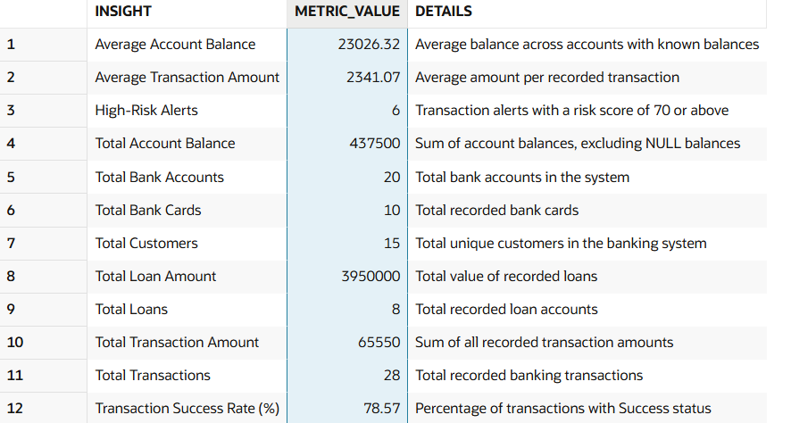

# 🏦 Banking Business Analysis – SQL Project

## 📌 Project Overview

This is a SQL-based **Banking Business Analysis Project** developed using Oracle SQL. The project focuses on analyzing banking data, customer accounts, account balances, transactions, data quality, and business performance.

The project demonstrates how SQL can transform raw banking data into meaningful business insights that support data-driven decision-making.

The project follows a complete data analysis workflow:

- Database creation
- Raw data loading
- Data quality auditing
- Data cleaning
- Data validation
- Table relationships
- Combined dataset creation
- Business analysis
- Advanced SQL analysis
- KPI analysis
- Business insights and recommendations

---

## 🎯 Business Problem

Banking organizations need to understand customer account activity, account balances, transaction patterns, and data quality to make better business decisions.

This project uses SQL to answer questions such as:

- How many customers and bank accounts are there?
- What is the total balance across bank accounts?
- Which customers have the highest account balances?
- Which account types hold the highest balances?
- Which customers have multiple bank accounts?
- How can missing, duplicate, or invalid records be identified?
- How can banking data be combined using SQL JOINs?
- How can SQL be used to calculate business KPIs?
- How can advanced SQL queries support banking analysis?

---

## 🎯 Project Objectives

1. Build a relational banking database.
2. Create tables and insert sample banking data.
3. Identify data quality issues.
4. Perform data cleaning and validation.
5. Establish relationships between banking tables.
6. Combine data using SQL JOINs.
7. Analyze customer and account information.
8. Calculate banking business KPIs.
9. Solve business problems using SQL.
10. Practice advanced SQL concepts.
11. Generate business insights from query results.
12. Organize SQL scripts and practice resources on GitHub.

---

## 🗄️ Database Structure

The project contains banking tables used to analyze customers, accounts, and related banking information.

### Main Database Components

| Component | Purpose |
|---|---|
| Banking Tables | Store customer, account, and related banking records |
| Data Quality Audit | Identify missing, duplicate, and invalid records |
| Data Cleaning | Clean and validate banking data |
| Combined Dataset | Combine related tables using JOINs |
| Final Banking KPIs | Calculate key business metrics |
| SQL Analysis | Answer banking business questions |
| Advanced SQL | Practice analytical SQL techniques |

---

## 📂 Repository Structure

```text
Banking-SQL-Project/
│
├── Final_Banking_KPIs/
│   └── Final KPI analysis files
│
├── SQL Queries/
│   └── SQL practice and analysis scripts
│
├── Tables/
│   └── Table creation and INSERT scripts
│
├── Banking_Final_KPIs_Image.png
├── SQL_Practice_Links.md
└── README.md
```

---

## 📊 Final Banking KPIs

The final banking KPI results are available in the `Final_Banking_KPIs` folder.

<p align="center">
  
</p>

These KPIs help summarize banking performance and provide an overview of the key metrics calculated through SQL.

**Note:** Refer to the actual KPI query results and image for the final metric names and values.

---

## 📚 SQL Practice Links

All SQL practice sections are organized in a separate Markdown file.

👉 **[Open Banking SQL Practice Links](SQL_Practice_Links.md)**

### Practice Sections

| No. | Section | Description |
|---:|---|---|
| 1 | Banking Tables | Create tables and insert banking data |
| 2 | Data Quality Audit | Identify missing, duplicate, and invalid records |
| 3 | Data Cleaning & Validation | Clean and validate records |
| 4 | Combined Dataset | Combine banking tables using JOINs |
| 5 | Final Business KPIs | Calculate banking business KPIs |
| 6 | Business Analysis | Solve banking business questions |
| 7 | Advanced SQL Challenges | Practice advanced SQL queries |

---

## 🧠 SQL Skills Demonstrated

### Basic SQL
- SELECT
- WHERE
- ORDER BY
- DISTINCT
- NULL handling

### Aggregate Functions
- COUNT()
- SUM()
- AVG()
- MIN()
- MAX()

### Grouping and Conditional Logic
- GROUP BY
- HAVING
- CASE expressions
- Conditional aggregation

### SQL Joins
- INNER JOIN
- LEFT JOIN
- Joining multiple tables

### Subqueries and CTEs
- Single-row and multiple-row subqueries
- Correlated subqueries
- Common Table Expressions (CTEs)

### Window Functions
- ROW_NUMBER()
- RANK()
- DENSE_RANK()
- PARTITION BY
- ORDER BY within window functions

### Data Quality and Validation
- Missing-value identification
- Duplicate-record detection
- Invalid-data checks
- Data consistency validation

### Business Analysis
- Account balance analysis
- Customer account analysis
- Account-type comparisons
- Banking KPI calculations

---

## 🔄 Project Workflow

1. Create banking tables.
2. Insert sample banking data.
3. Perform a data quality audit.
4. Identify missing, duplicate, and invalid records.
5. Clean and validate the data.
6. Combine related tables using JOINs.
7. Analyze banking data using SQL.
8. Calculate final business KPIs.
9. Solve advanced banking business questions.
10. Document the SQL scripts and results on GitHub.

---

## 💡 Business Value

This project demonstrates how SQL can help banking organizations:

- Improve data quality and consistency.
- Understand customer account balances.
- Compare account types and customer activity.
- Identify duplicate and invalid records.
- Generate banking performance reports.
- Support data-driven business decisions.

---

## 🛠️ Tools and Technologies

- **Database:** Oracle SQL
- **SQL Practice Environment:** [FreeSQL](https://freesql.com/)
- **Version Control:** Git
- **Project Hosting:** GitHub
- **Domain:** Banking and Financial Data Analysis

---

## 👨‍💻 Author

**V Tharun**

Aspiring Data Analyst

**Skills:** SQL | Excel | Power BI | Python

---

## 🔗 Project Resources

- **SQL Practice Links:** [View Practice Resources](SQL_Practice_Links.md)
- **SQL Editor:** [FreeSQL Online SQL Editor](https://freesql.com/)
- **KPI Image:** `Banking_Final_KPIs_Image.png`

---

⭐ If you find this project useful, consider giving the repository a star!

This project was developed for SQL practice, banking data analysis, and data analyst portfolio development.
